# AI 时代：从研发提效到全面提效，再到产品策略的一些思考

> 本文保留原文写作时的观点、数据及时间口径。涉及内部组织、人员和部门的信息已匿名化，配图已作脱敏处理。

## 摘要

### NotebookLM 摘要

- 本文探讨企业如何通过 **“通用智能体（Common Agent）+ 技能库（Skills）”** 的架构实现组织进化。
- 三步走战略：首先**在研发端建立标准化规范，验证技术可行性**；随后**通过管理层带动，将 AI 提效推向全员**；最终**将内部沉淀的专家经验转化为具备竞争力的 SaaS 产品策略**。
- 核心理念是**将复杂的业务逻辑封装为可复用的技能单元**，实现**从个人提效到组织能力规模化复用的跨越**。
- 通过 Agent 平权，让 AI 深入业务流程，应对未来市场的竞争挑战。

### 作者摘要

**复利工程。**

## 第一章：研发提效

### 看法

- **效率提升一定要遵循均值回归的客观规律。** 如果出现远超过主流提效水平的数字，例如平均提升 20%，而我们提升 200%，就需要反问：我们哪里比别人做得好这么多？使用相同的工具，为什么提效差距如此之大？数据有没有水分？
- AI 不仅是“高绩效员工的识别器”，**更应成为“组织能力跃迁的核心动能”**。
  - 优秀员工借助 AI，工作能力可能显著提升，从而与普通员工拉开差距。
  - 作为组织，核心是**让木桶最短的一块板子越来越长，让普通员工更容易成为优秀员工，使专家经验可以被复制**。
- 员工能力的普遍提升，**离不开标准化能力复制体系的建立。AI 时代的员工培训需要被重新定义。**
  - 视频培训容易碎片化，缺乏体系，难以拼接成完整的能力。

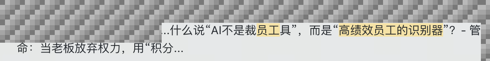

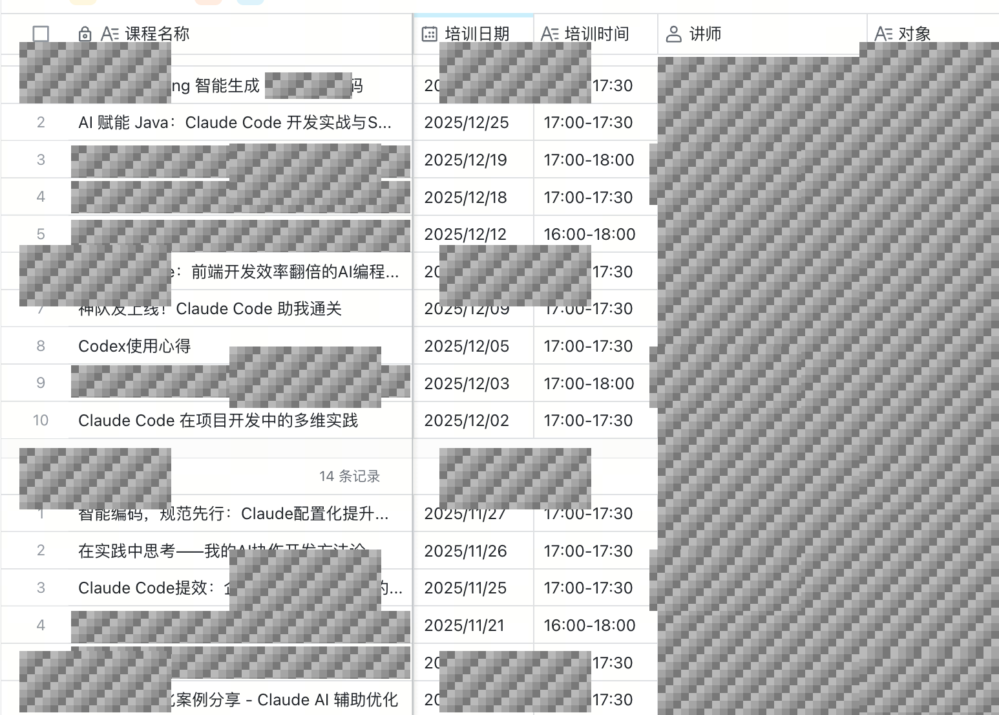

### 策略

**制定 AI 研发标准规范，并提供一系列工具，支撑研发工作流落地。**

- Java 开发规范。
- 前端开发规范。
- 符合 AI 研发工作流的 TDD 开发模式。
- 工具支持，包括 CI/CD 流程。

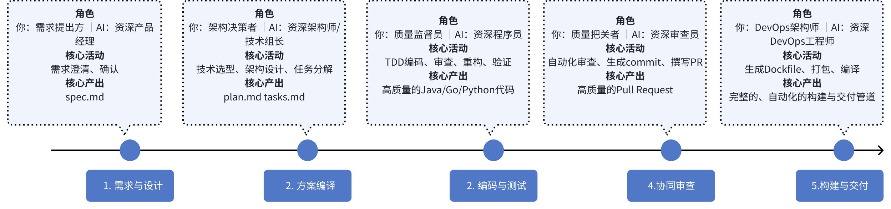

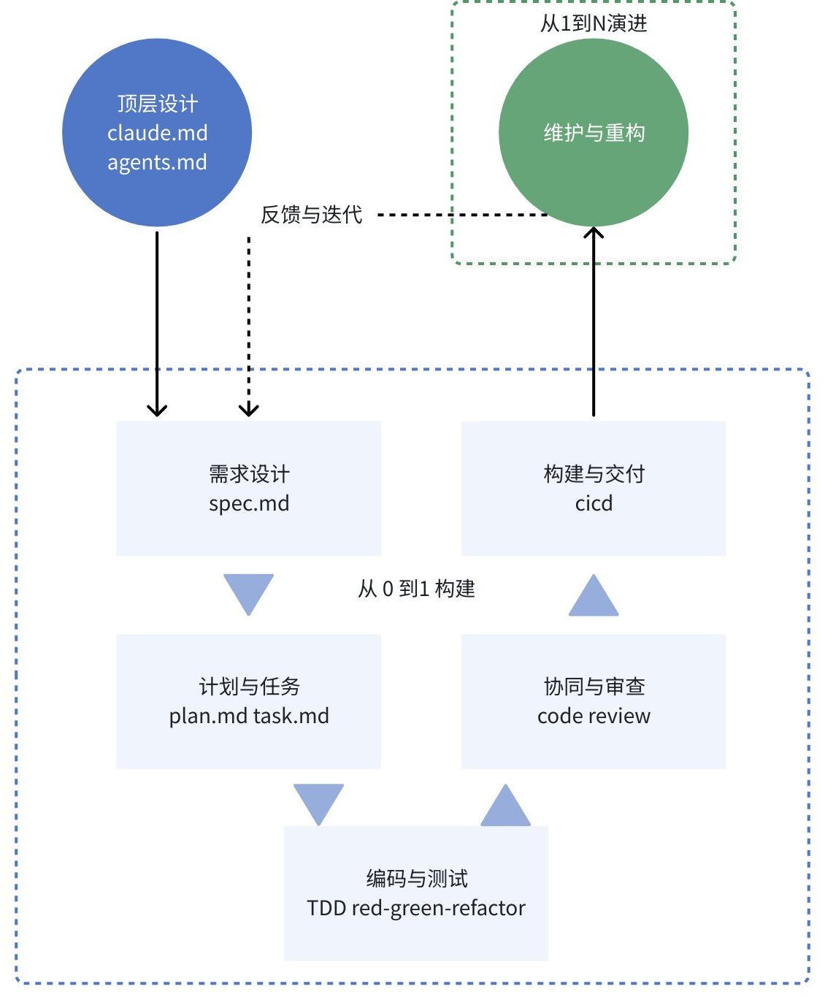

## 第二章：全员提效

**管理层提出的全员 AI 提效计划，如何落地？**

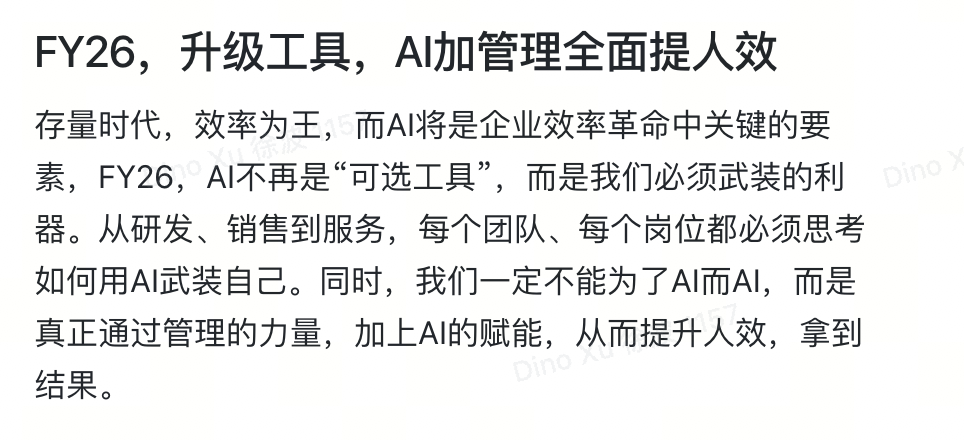

### 看法

- **需要设计一种统一的方式，成为全员提效的可靠路径。**
- **主流 Coding Agent 正在自然演变为 Common Agent。** 它们不仅用于编程，也可以成为提高各类业务效率的办公生产力工具。
  - Claude Code SDK 更名为 Claude Agent SDK。
  - Anthropic 为 Claude 推出了 Cowork 模式。
- **Agent Skills 的快速普及，为 Common Agent 成为垂直领域专家提供了标准化路径。**
  - 将专家经验、流程规范、业务流程以 Skills 的方式实现，具备可移植性。
  - Agent Skills 已成为事实标准，国内外主要厂商纷纷跟进。
  - 原文记录：截至 1 月中旬，开源 Skills 已接近 6 万个，后续更新记录为 74,380 个；到 1 月 27 日，已突破 10 万个。
  - 同期，内部平台团队孵化中的技能约有 10 个。

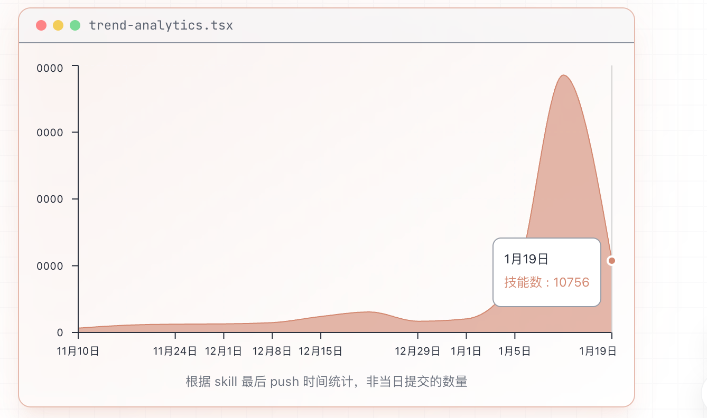

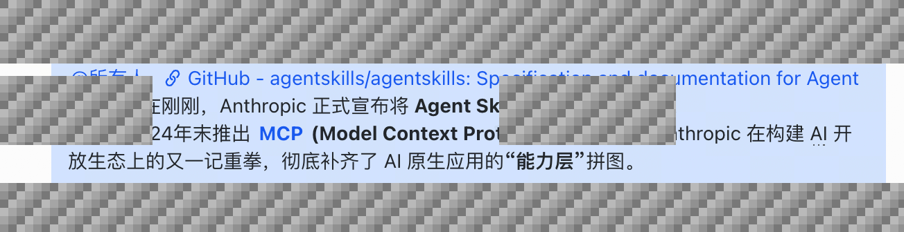

### 策略

**Common Agent + Skills：将研发团队的 AI 提效工具推广到全公司，形成统一的使用方式。采用自上而下的推进方式，由高管和主管示范，促使各团队在日常工作中使用、制作并分享 Skills，转向 AI 协同工作模式。**

- 高层支持，各团队负责人带头使用并分享。
- 各团队积极将日常工作流程、规范等封装成 Skills，在制度上鼓励高贡献的员工。
- 建立指标跟踪体系：
  - **技能贡献数量**：鼓励创作。
  - **技能使用频次**：促进复用。
  - **技能覆盖的工作范围**：衡量各团队参与度。
  - **技能对日常工作的替代程度**：核心指标是**多少工作被 AI 接管**。
- 由平台团队提供 Skills Market，作为组织检索、学习、下载 Skills 的统一入口。

> 将 Skills Market 打造为组织工作经验**体系化沉淀、专业化传承、规模化复用**的数字知识宝库。

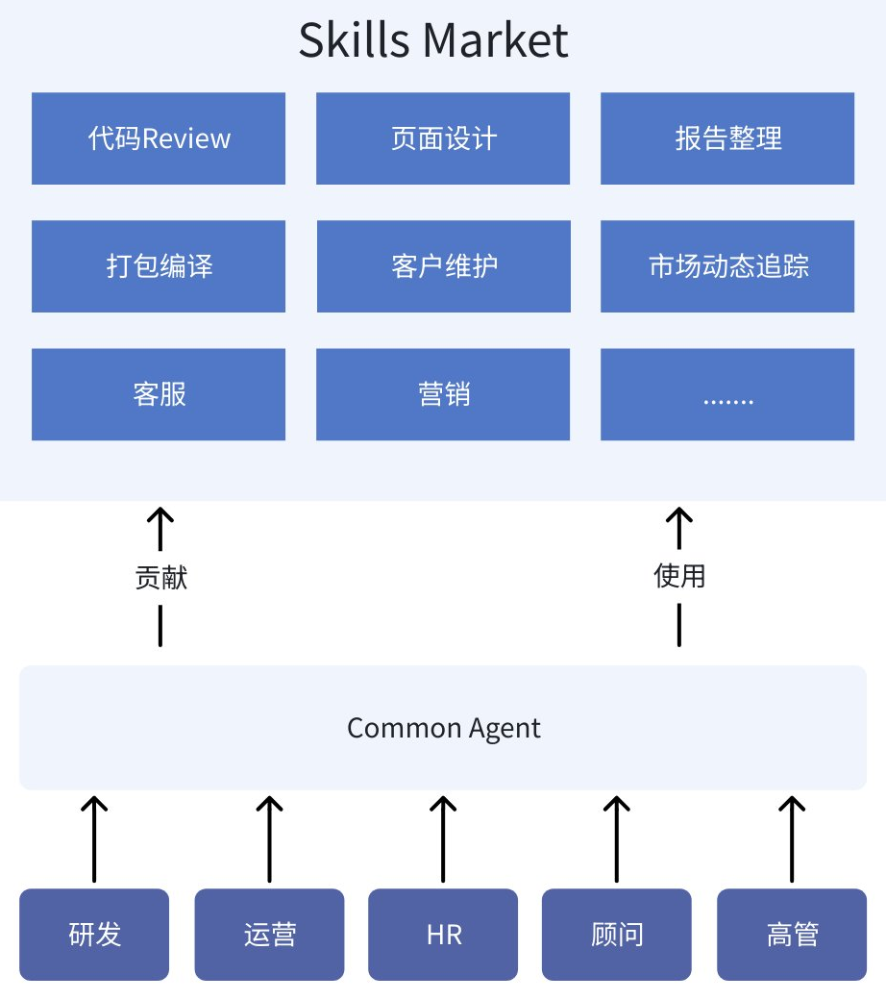

**内部 Skills Market 的首个版本于 2026 年 1 月 23 日面向开发者发布。**

## 第三章：产品策略

### 看法

**虽然业务千差万别，但组织的底层运转逻辑大同小异。Common Agent + Skills 如果在内部验证可行，同样可以应用到 SaaS 产品上。**

组织的底层运转逻辑，是**为了完成既定目标，把一群人的工作变成可协同、可复用、可优化的整体过程**，核心围绕四件事循环：

1. 把各类工作拆成**标准化流程和动作**，例如日常作业规范、协作步骤。
2. 让员工在流程中**沉淀经验、积累方法**，例如完成某项工作的最优路径、避坑技巧。
3. 让这些经验和方法**快速传递、复用**，避免每个人从头摸索，提升整体效率。
4. 基于复用结果**持续优化流程和方法**，让组织的整体能力越来越强。

研发、销售、行政等岗位的工作看似不同，本质上都包含这四件事。

#### 外部趋势

**AI Agent 正在接管更长周期、更复杂的工程任务，整个行业的工作方式也将随之重塑。**

- Gartner 在 2025 年 9 月的新兴技术成熟度曲线报告中提出：**AI Agents 已经登顶**。
- Gartner 建议**企业将 AI Agents 纳入战略规划**，逐步建立“人在回路”（human-in-the-loop）的监督机制。

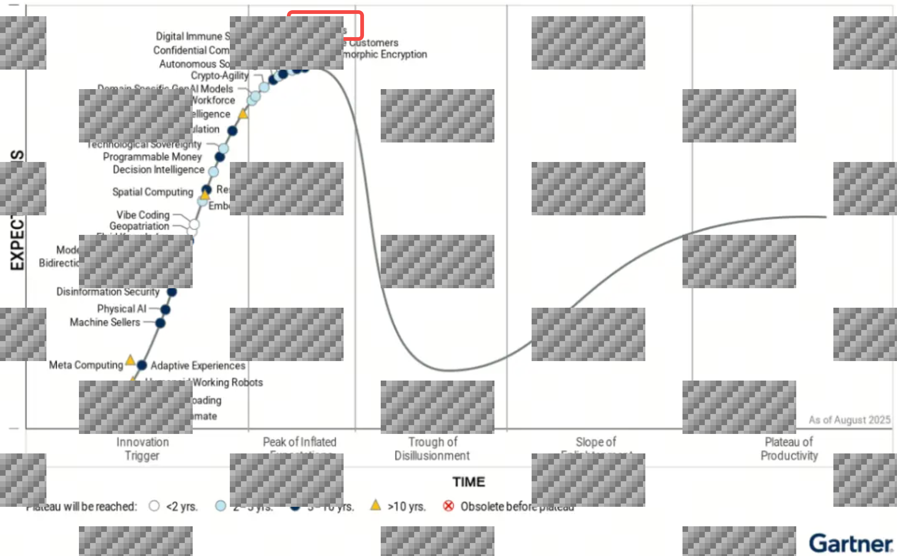

我的个人判断比 Gartner 更激进：AI Agent 的迭代应以月计算。理由是，**从 2025 年 9 月到 2026 年 1 月，已经发生了重大变化**：

- **2025 年 12 月**：Manus 以数十亿美元被 Meta 收购，Common Agent 的价值被重新定义。
- **2025 年 12 月**：Skills 标准开源，国内外主要厂商跟进，使通用 Agent 转变为垂直领域专家有了共同路径。
- **2026 年 1 月**：在海外企业市场，Anthropic 为 Claude 推出 Cowork 模式，提供给非开发人员日常办公使用，可以理解为界面化的 Claude Code。
- **2026 年 1 月**：在国内消费市场，阿里千问打通阿里生态。
- **2026 年 1 月底**：开源社区的 molt.bot（原 Clawdbot）甚至带火了 Mac mini。

**一批 AI Native 产品已经或正在走出来，发展迅速：**

| 类型 | 产品示例 |
| --- | --- |
| 通用 Agent | Manus、Claude Code |
| 设计 Agent | Lovart |
| 法律 Agent | Harvey AI |
| 内容创作 Agent | Notion |

#### 产品现状

**可能会陷入“追赶者困境”。**

- **技术上**：
  - 采用 Java 技术栈，工具本地化，未实现 MCP；是否采用 ReAct 模式尚不明确。
  - 复用到其他业务线时，仍依赖复制项目、删除不必要代码。
- **产品上**：仍是“传统 Web 界面 + Chatbot”的形态。
- **战略上**：当时的年度规划中，尚未形成 AI 产品战略。
- **商业认知上**：投资人的 AI 认知值得学习。过去一年，我的很多相关知识来自拾象科技。

#### 我心中未来的产品形态

- 功能原子化、调用智能化。
- 产品的学习成本越低，用户黏性越高。

**表现形式**

- 以对话为核心，传统 Web 页面被折叠。
- AI 交互成为核心，业务表现形式融入 AI 对话界面。

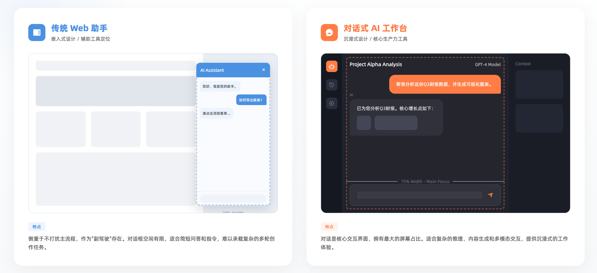

**部署形式**

本地客户端会再次复兴吗？我个人倾向于认为会。

- **Web（B/S）**：安全性较高，但本地文件操作受限，通常使用上传、下载替代。
- **客户端（C/S）**：操作能力更强，但安全性会受到挑战，例如误执行破坏性文件操作。

浏览器端示例：

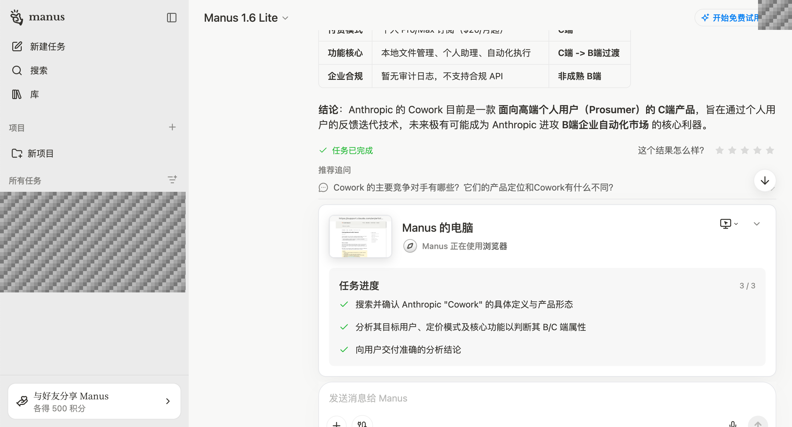

客户端示例：

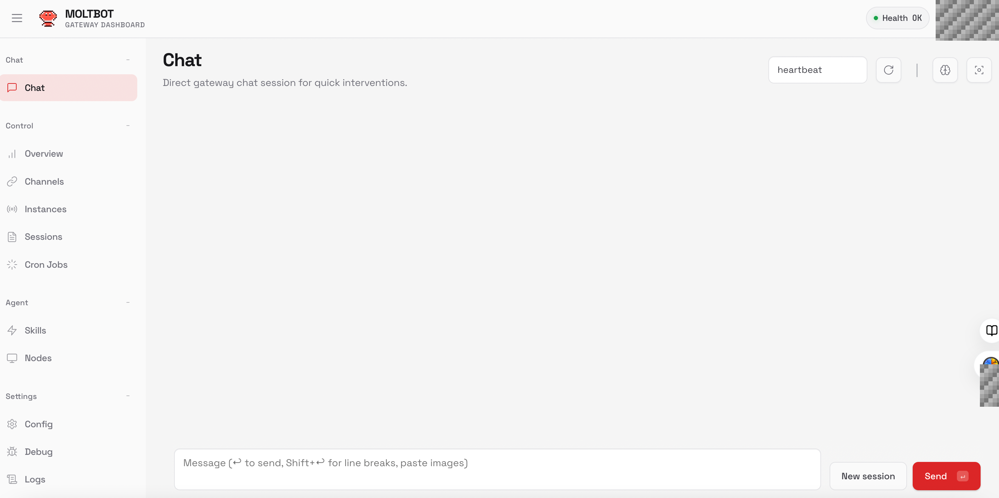

**业务形式**

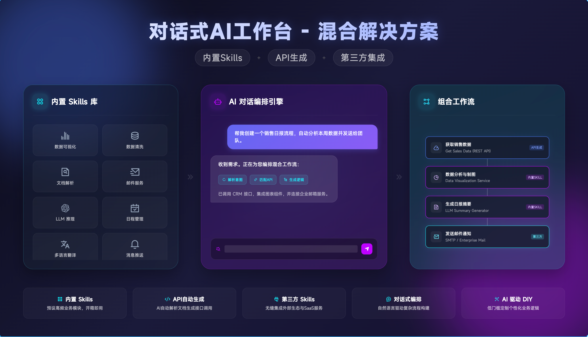

- 突破 SaaS 本身的业务边界，打开新的想象空间。
- 形成 **SaaS 固定业务 + 内置 Skills + 基于 API 的个性化定制 Skills + 个人其他办公工具 Skills** 的混合解决方案。
  - 个性化部分不必完全依赖专人定制，用户可以自己 DIY。

#### Open API 的战略意义

**无论着眼现在还是将来，投资 Open API 都有价值：**

- 传统业务集成依赖 Open API。
- Skills 的业务执行，本质上仍是调用业务 API。没有 API，就没有业务执行类 Skills。
- Open API 要确保“Agent 平权”：数量多不等于有用，能够支撑业务执行才有意义。

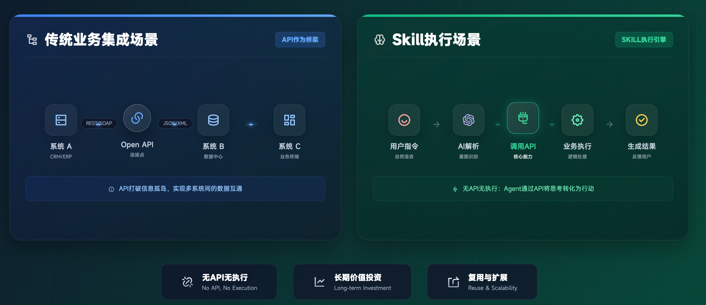

### 策略

**基于全员提效的经验和工具，以低成本切入 SaaS。在日常产品开发中实现 Agent 平权，将专家经验、业务流程、行业 Know-how 封装为可执行单元（Skills），应对未来的“追赶者困境”。**

- 将内部平台功能进行 AI 折叠，在提效的同时验证路径的正确性。
- 升级 Skills Market，使其既支持组织内部使用，也成为业务的 AI 技能库。
- 深耕行业 Know-how，实现 Agent 平权。产品经理和开发人员在实现每个功能时，都应问：**Agent 可以实现这个效果吗？如果不能，就添加相应的原语工具。**
- 既定战略目标不能打折扣。Open API 一定要落地业务集成场景，**重视质量、兼顾未来、拒绝返工，实现 API 级别的 Agent 平权**。
- **职责分离**：
  1. 业务团队专注于 Skills 建设，避免重复投入 Agent 工程化。
  2. 拥抱 CLI（Command Line Interface，命令行界面）。

> **“Whatever you build, start with a CLI.”**
>
> 无论做什么 App，先做 CLI 版本。Agent 调用 CLI 方便，测试 CLI 也容易。GUI 可以作为 CLI 的界面层；内核跑通后，再由 AI 辅助构建 React 界面。

## 总结

### 组织

基于既定的年度战略，在为组织赋能的同时，使用相同的方法论，以低成本在产品侧做成果转化，为 SaaS 进入“AI 应用新阶段”做好技术与业务储备，应对未来的“追赶者困境”。

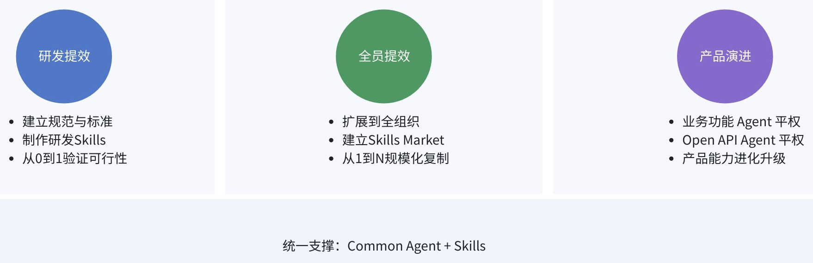

### 个人

- 通过 Agent 使用 Skills，可能成为 2026 年每个人都需要的新能力。
- 这个时代，我们不一定需要成为 Superman，而可以成为借助外部能力的增强个体：不一定亲自拥有所有能力，但要能够自主调用这些能力。
- 今天，整个 GitHub 都可能成为你的能力来源。
