# 为什么说 Common Agent + Skills 是“全员提效”的有效路径

> 本文根据原文整理为 Markdown。涉及内部人员、组织、系统和资料的信息已作匿名化处理；部分含内部信息的配图已模糊化，演示视频未收录。

为什么说 Common Agent + Skills 是“全员提效”的有效路径

# **SaaS又死了 -- Claude一个插件吓哭华尔街，软件公司集体暴跌，2万亿元一日蒸发**

- https://github.com/anthropics/knowledge-work-plugins/tree/main/legal/skills

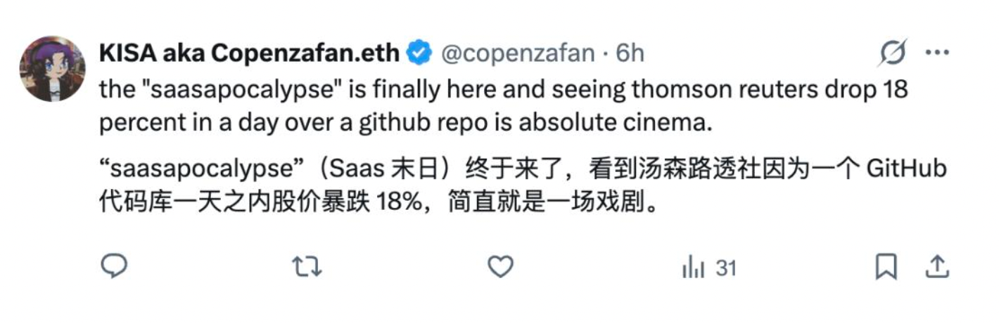

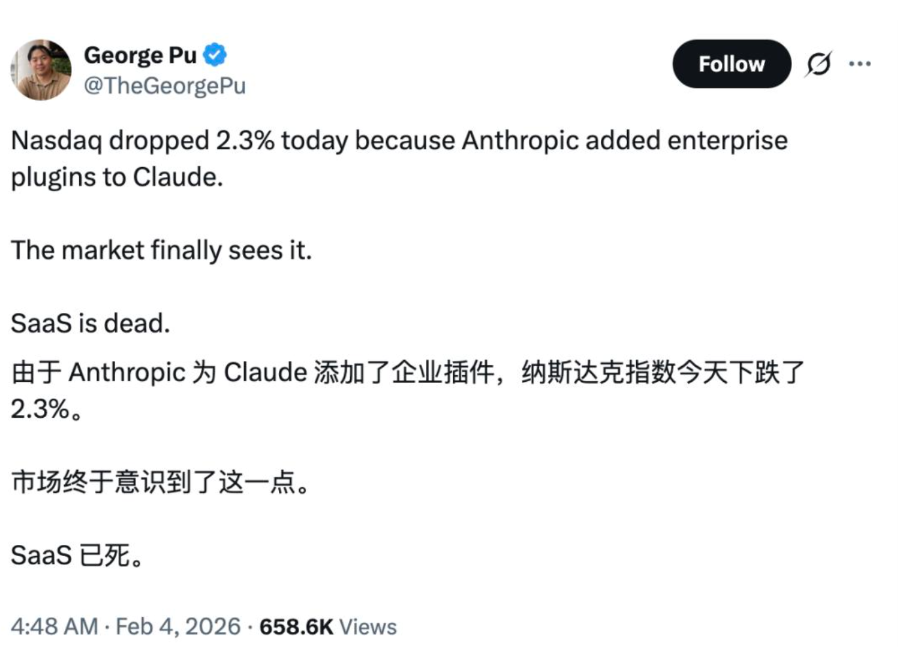

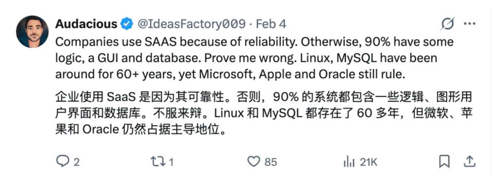

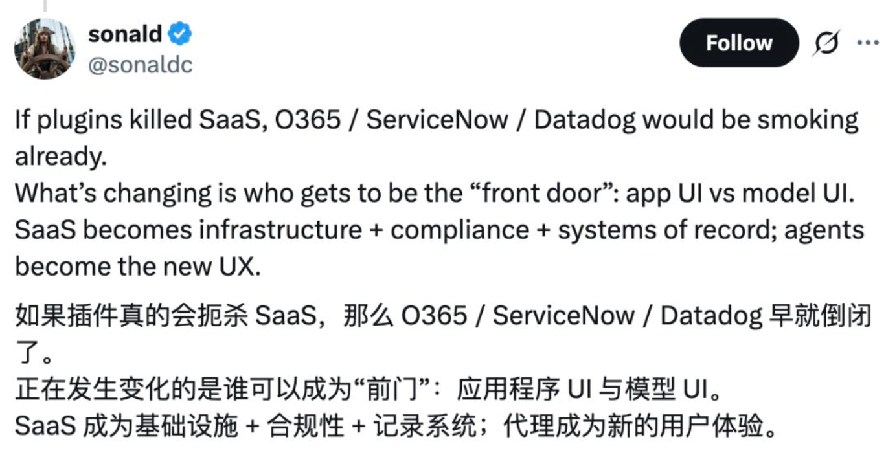

# 2025年最具代表性的 3 个Common Agents

## Manus -- Common Agent 由我来“定义”

- https://manus.im/app

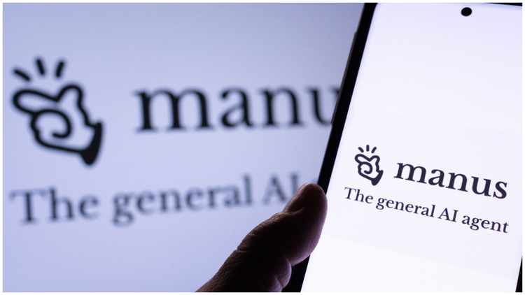

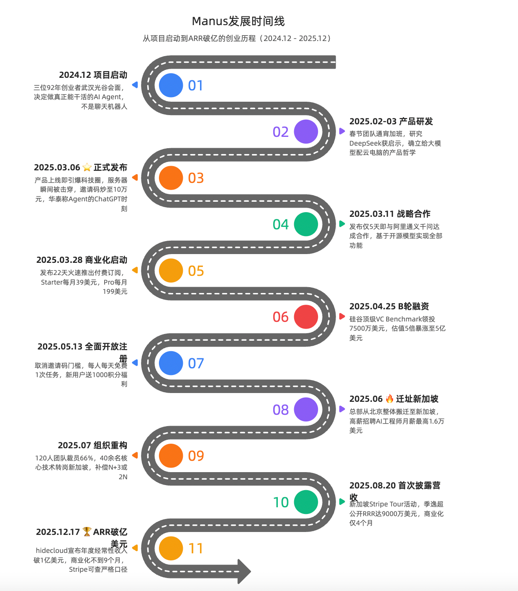

- 商业上：Manus 被视为较早跑通 PMF（Product-Market Fit） 的代表。

- 目标：海外市场

- 产品愿景：心手合一 -- 让智能真正触及现实世界，不做“理论物理学家”

> 模型解决的是智力问题，但是再强的智能，也没有办法把环境给内化掉，所以这就需要一双手，来去触及到现实世界。

- 产品思路：

- 来自 Cursor（一款AI编程产品）的启发：内部非工程师使用Cursor -- 运营同事写博客、数据分析同事数据分析与可视化

- 被动接受 AI 操作，对于不懂技术的人，存在天然的恐惧感 -- Cursor的形态对用户不是最优的

- 做观察者：用户应该可以按他的想象力去使用这个产品，通过观察用户在使用过程中整体的一个行为模式，去捕获到通用的场景，去做最后一公里的优化

- 产品形态：在云端可以异步执行，通过连接各种扩展，帮助所有知识工作者完成复杂工作的Common AI Agent

> **Manus 为什么不选一个领域进行深耕？**
> - 技术上
> - 专有模型被通用模型吃掉是很正常的事情
> - 通用模型+图灵机 理论上可以做任何东西
> - 通用的技术架构的优势 -- 用户可以按他的想象力去使用这个产品，不去引导用户做什么，而是看用户喜欢做什么
> - 产品上：
> - 很多能力最后会收敛，大家都会有，比如说之前很火的deepresearch
> - 通用产品有更大概率来服务用户的方方面面
> - 让 “长尾”用户满意，能够让用户出现 “aha moment” ，让用户获得极大的满足感

## Claude Code（以下简称CC）-- 一个被用户搞的“*不纯粹*”的“Code Agent”

- 工程上 -- 它是我心目中的 SOTA：https://www.anthropic.com/engineering

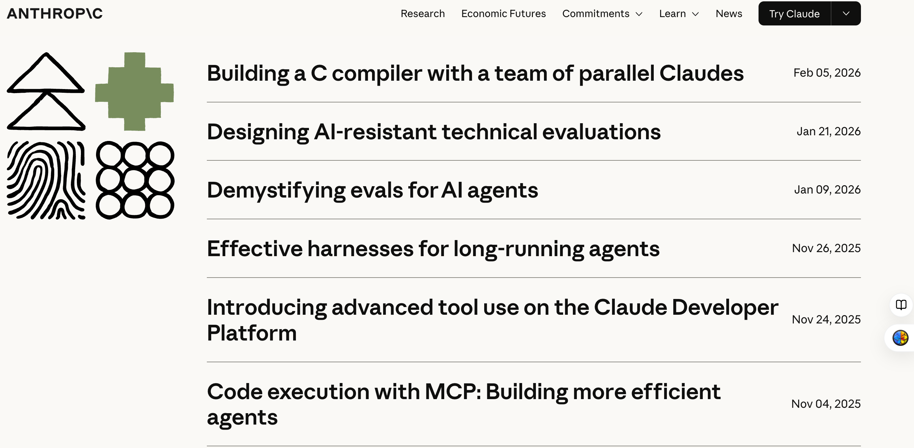

- 产品形态：相比于manus ，它一般运行在本地，代码能力T0级别，一样是Common Agent，支持各种插件

- 目标客户：开发者 -- 能力自然延展，覆盖到 “几乎所有的脑力工作者”  为什么会这样？-- 因为用户已经在这样用了。

- SDK 更名 -- Claude Code SDK ===> Claude Agent SDK

- 推出CoWork （GUI CC）-- “*not just developers*”

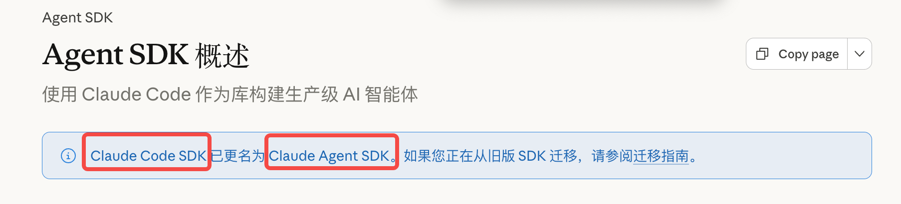

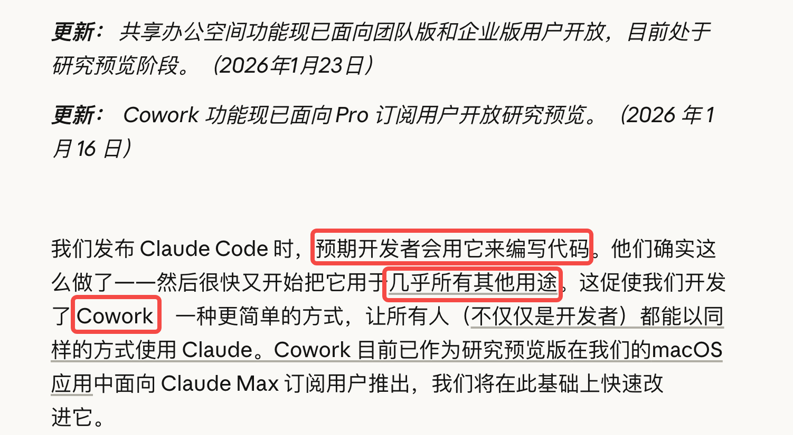

## Open Claw -- 现象级开源，7天10万星，mac mini你买了吗？

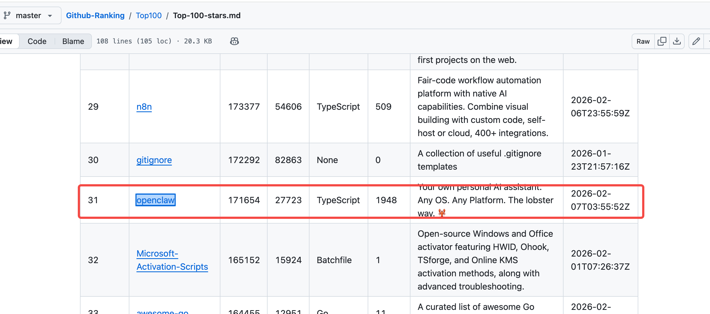

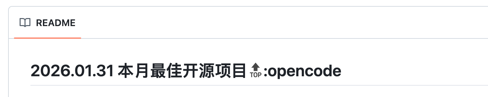

- 特点1：真正能在 Personal 的基础上做到 Long Horizon Tasks。

- 特点2：扩散效果好 -- 通过 IM Gateway 直接嵌入了用户的日常沟通流 （飞书、企微、whats app、slack）。

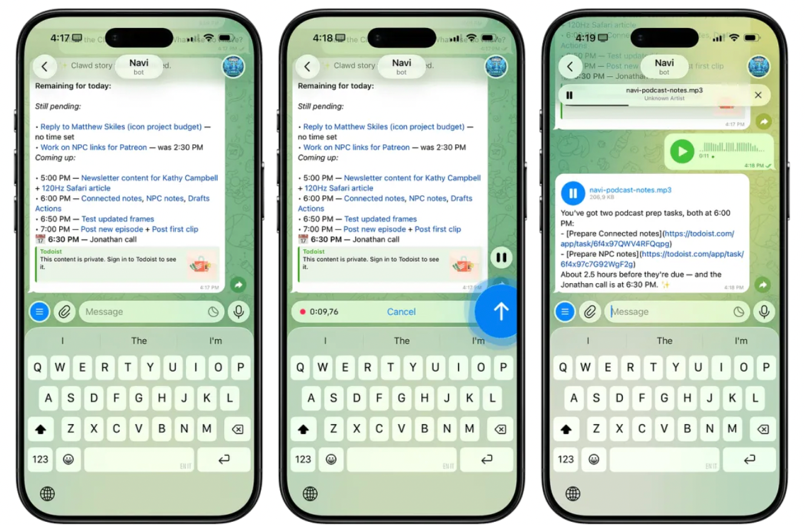

- 特点3：预装技能 -- 像于早期智能手机预装应用超市和 Use Case 来教育用户如何使用智能机一样，来降低用户的使用门槛。

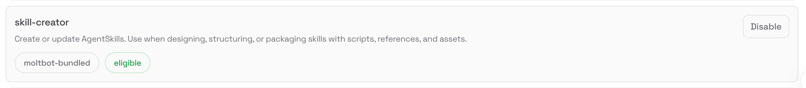

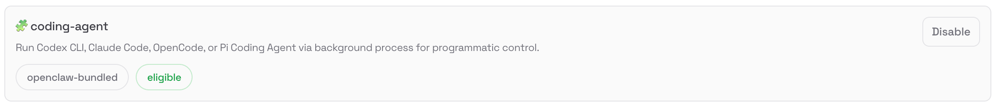

- 特点4：SOUL -- 真的是在设计一个“有血有肉的人类”，同时还在“建模用户”

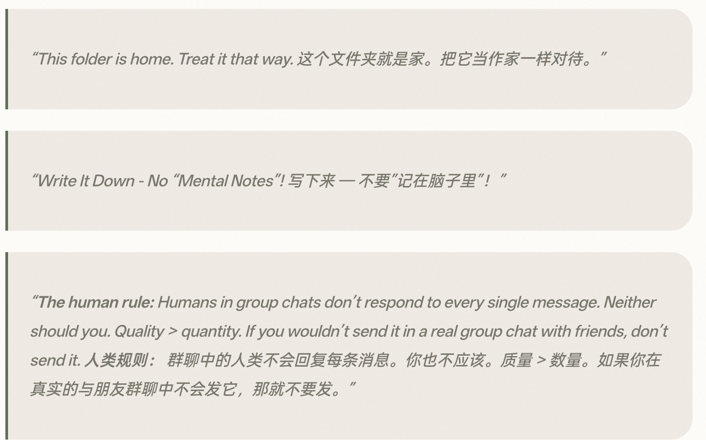

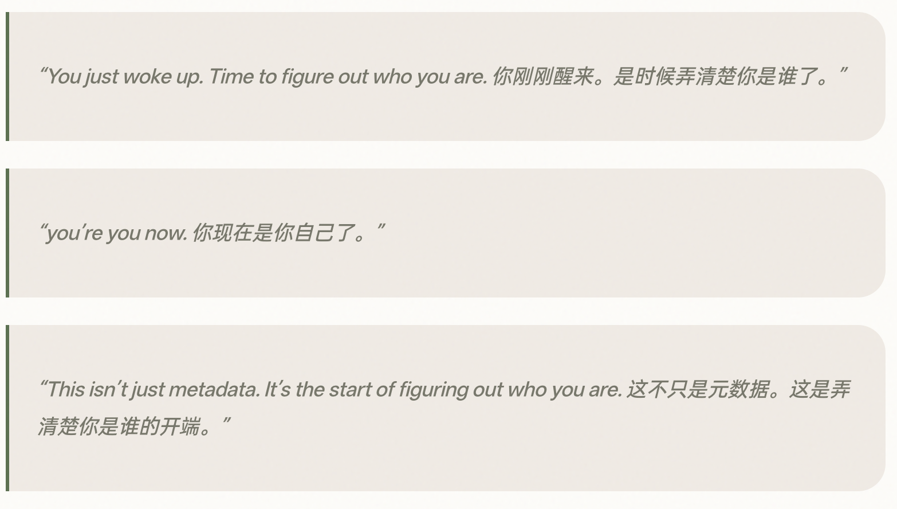

## 总结

|  | 产品形态 | 界面 | 是否支持Skills | 部署形态（一般） | 适用人群 | 市场 |
| --- | --- | --- | --- | --- | --- | --- |
| Manus | Common Agent | GUI | 是 | 云端 | 所有知识工作者 | 海外 |
| Claude Code | Common Agent | TUI + Cowork GUI | 是 | 本地 | 硬核开发、所有知识工作者 | 海外 |
| Open Claw | Common Agent | TUI + GUI | 是 | 本地 | 所有知识工作者 | 开源 |

### Common Agent 产品底层逻辑

- “Common中的垂类” -- 做一个不断优化的头部场景

- Claude code -- 软件研发

- Manus -- deep research

- 保持很强的“长尾能力” -- 当系统有足够多的可以被hack的点，观察用户怎么“滥用它”。当你看到用户用你的产品做一些你完全没想到的事情时，那就是潜在需求。

- 选择高频的潜在需求，通过插件/skills 的方式产品化这些场景

- 一个Common Agent 底座中，让不同场景之间有更好的协同性，并且互相增强相互的网络效应

# Common Agent 能力解读

## 强大的内核支撑

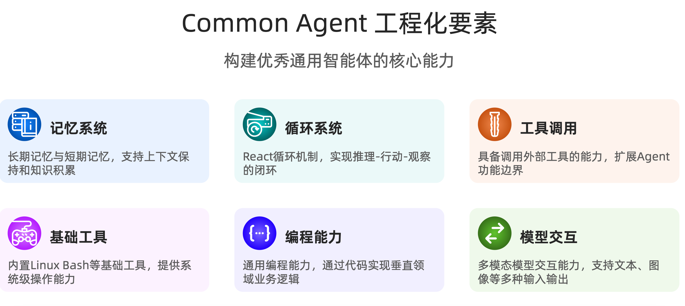

## 能力边界在哪里？

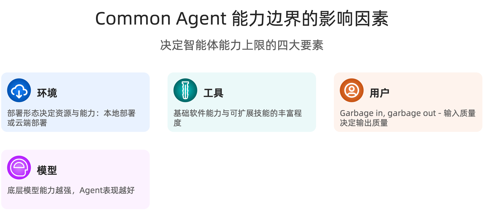

## 一流厂商定标准，三流厂商做产品 -- Anthropic：“老子全都要”

### MCP 标准 -- 旨在为 AI 模型与外部资源之间提供统一的连接方式。

- 由 Anthropic 于 2024 年推出，25年12月被捐献给 Agentic AI Foundation，成为通用标准。

- MCP 希望能够像 USB-C 接口一样成为 AI 系统与各种数据源和工具之间的“通用接口”。

- 不同的 AI 应用可以轻松与多种数据源、工具进行“即插即用”的连接，无需再为每种不同的数据源开发独立的集成方法。

### 标准之殇

- 上下文过长容易导致模型能力下降： MCP要求把工具的完整定义给到模型，工具越多，占用的模型上下文越大，模型还没开始干活呢，就已经“撑死”了

### 从MCP 到 Skills，即是工程上优化，也是范式转移

- **工程巧解**： Anthropic 为了解决工具调用带来的胖上下文问题，提出了“渐进式披露/加载”的解法，从而推出了Skills

> 如果你希望了解“渐进式加载”，我强烈建议你去阅读这篇文章：[从《塞尔达传说》到AI Agent：Claude Skills背后的信息分层设计哲学](https://mp.weixin.qq.com/s/F9BtGpZNQxLkalg62ayBXw)

- **宽松的架构设计：**仅仅是信息分层不足以引起“能力涌现”，更巧妙的是它让一个没有编程能力的人，仅仅**依靠语言组织能力**，就可以低成本创造出AI可执行的技能，这让它具备了“**广泛的群众基础**”

# Skills -- 范式转变，从面向人类交接到面向Agent交接

> 想象你要把一项工作交给新同事。要是不能口头传达，只能通过文档交接（并且你想一次就交接好，之后别再被打扰），你会准备什么？
> - 任务的执行 SOP 与必要背景知识（这件事大致怎么做）
> - 工具的使用说明（用什么软件、怎么操作）
> - 要用到的模板、素材（历史案例、格式规范）
> - 可能遇到的问题、规范、解决方案（细节指引补充）

## 拆解“交接大礼包”

Skill 的设计架构，几乎是人类交接大礼包的数字版本：

- 在 Skill 中，指令文档用于灵活指导，代码用于可靠性调用，资源用于事实查找与参考。

## 那个干掉几千亿美金市值的插件长啥样？

## Skills vs 传统AI工作流

> 原文包含内部流程画板，本版本已隐藏画板内容。

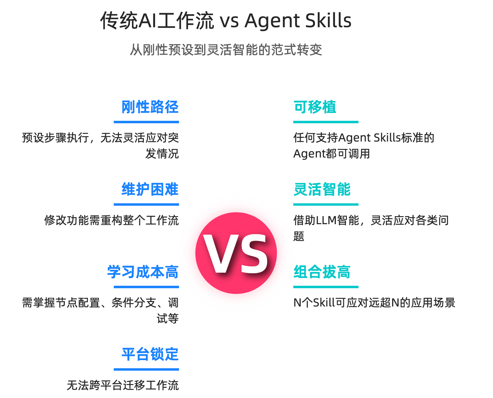

> - **Skills 与Workflow是可以融合的**：在特定的业务场景下，刚性代表确定性，灵活意味着不可靠，通过Workflow 封装确定性，由 Agent 承担类似 hook 的角色，直接触发

# 回答 - 为什么说 Common Agent + Skills 是“全员提效”的有效路径

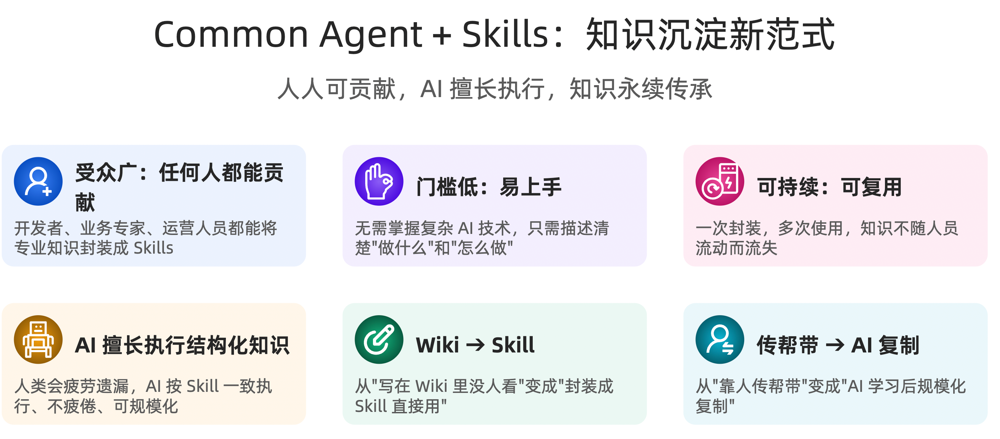

# 真AI Native 产品未来的发展趋势

### 知识型SaaS：**重构护城河，价值锚点迁移**

- 知识型SaaS（专家经验数字化）依赖信息获取和整理，受冲击影响大，市场在重新定价

**Thomson Reuters 股价被击穿的背后逻辑**

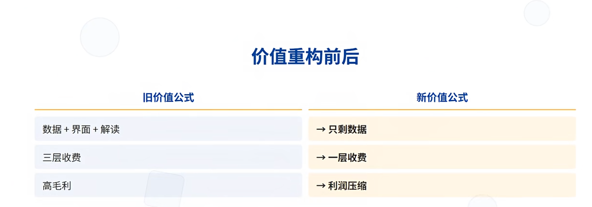

- 重构护城河，价值锚点迁移

- 不堆叠功能

- 往数据独占方向走 ===> 这部分是通用模型无法训练到的

- 与客户建构信任链===> 基于墙内数据打造的可信任链：出事了，我可以负责，你行吗？

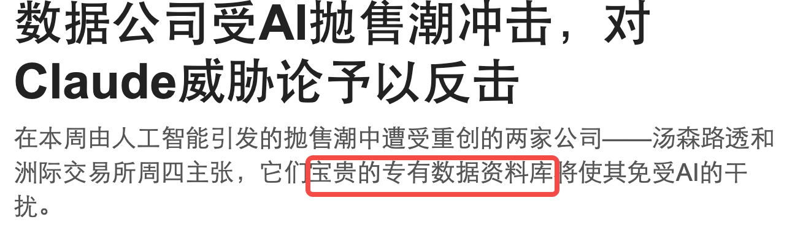

### 流程型SaaS： **新的交互范式 -- Workflow In Chat**

- 流程型SaaS因严密的业务逻辑，0容错，护城河很高

- **观点1：逐步失去入口控制权**

- Agent 交互友好性，AI 对话成为主要入口

- 继而失去前端界面交互的定价权，逐渐从前端的操作软件演变成后端的CRUD 接口/数据库

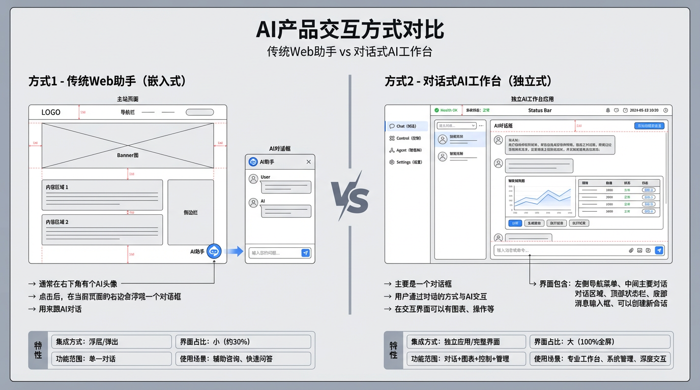

- **观点2：定制化服务溢价被击穿**

- 交付被卷：Coding Agent 能力这么强，交付为什么这么慢？

- agent高扩展性：有没有原子API，做没做到Agent 平权，直接让agent 定制行不行？

- **观点3：新的交互范式 -- LUI（language user interface） + GUI in Chat + API Action**

- LUI：对话入口，通过对话+文件+语音进行意图识别

- GUI in Chat：动态更新、原生媒体预览、状态持久化，以及直接的可视化操作流程

- API Action：接口、MCP Server 以及Skills

> **3大要素加速这一范式落地**
> - 体验既效率：LUI 极简的操作方式，让用户通过对话调动复杂的业务系统
> - 个性化需求的即时满足：无需排期，agent 实时理解业务意图，动态渲染出符合标准的前端组件
> - 甲方数据主权：一旦新交互范式普及，那么甲方一定会将其写入招标要求

- **观点4：商业价值分化**

- Level1：infra - 提供API 基础调用，沦为驱动他人界面的“**哑**”后端。

- Level2：数字员工 - 切分客户的工资体系，而不是 IT 预算

### 构建AI Native 应用的5大原则

要构建 Agent-native 应用，我们需要遵循以下 5 大核心原则：

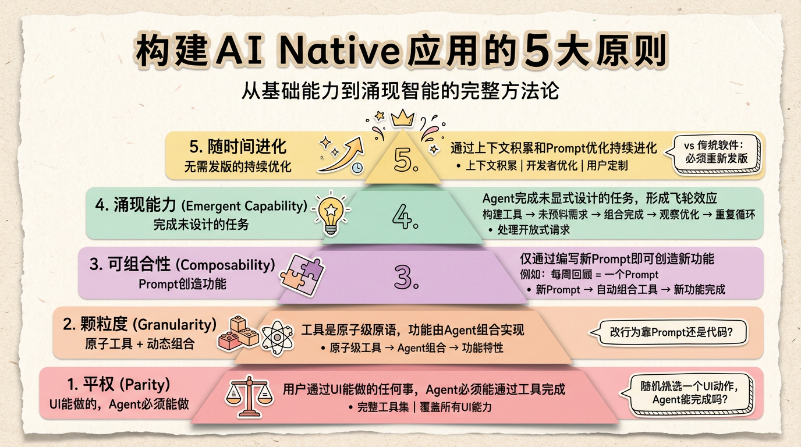

# 组织实践：Skills 的应用思考与实践

## 高频且碎片化的，容易打断工作主线的协作事项

- 用户自己去做，而且不需要知道在入口在哪里

> 原文包含演示视频，本版本未收录视频。

## 数据分析 -- 不只是提供图表，而且是从专业角度洞察

- 图表出现的意义是为了帮助人类更加方便的总结信息

- 大量图表反而会分散人的注意力

- 通过AI总结，直接给到人类想要的信息

> 原文包含演示视频，本版本未收录视频。

**之前**

**现在**

## 专家经验沉淀 -- 让你的Agent 也成为专家

- 背景：公司万年Java8的服务要统一升级

- 以前的方式：一位 Java 技术专家 先趟坑 -- 实验+总结，给出文档 ，再交接给其他团队，其他团队参考文档升级

- 现在的方式：文档变成了技能，Agent直接学习使用，单个项目升级可以从2天缩短到2小时

## 用 Skills 串联研发工作流

> 原文包含内部流程画板，本版本已隐藏画板内容。

- 研发工作流的每个节点，都需要Skill的支撑

- Jira分析 -- 通过分析Jira与AI共创需求

> 原文包含演示视频，本版本未收录视频。

## 知识库 -- 不要再开通文档权限（待制作）

- Skill 架构天然适合做知识库

# 普通人如何开始

### 首先得安装1个可以工作的Common Agent

| Agents | 是否需要下载 | 是否需要付费 | 是否有图形界面 | 推荐指数 | 备注 |
| --- | --- | --- | --- | --- | --- |
| Claude Code CLI | 是 -- 找 | 公司统一支付费用 | 否 | 5 |  |
| Codex CLI | 是 -- 找 | 公司统一支付费用 | 否 | 4 |  |
| Codex Mac App | 是 -- 下载地址： https://openai.com/zh-Hans-CN/codex/get-started/ ，且找 | 公司统一支付费用 | 是 | 4 | - 非开发者，Mac OS 用户推荐 |
| Manus | 否 -- 登陆注册：https://manus.im/app | 非Pro版本每天有固定额度 | 是 | 3 | - 本地文件需要通过上传、下载操作 - 不能连接处理公司内部业务，适用个人 - 模型效果不保证 |
| Trae | 是 -- 下载地址：https://www.trae.ai/ | 非Pro版本每天有固定额度 | 是 | 3 | - 模型效果不保证 |

> 如果以上都不满足，你再等等 正在加紧制作 Claude Code 桌面版本

### 一切从学习如何使用Skills 开始

- Github 上有超过10万个技能，覆盖了日常办公领域的各个方面

- 组织内部的 Skills 平台

> - 你们肯定希望可以一键安装skills，请耐心等待【Skills 一键安装】 -- 一键安装已经支持
> - 你们肯定希望可以快速找到你想要的skills，请耐心等待【Skills 检索】

#### 示例1：还是那个超贵的法律咨询技能

- 此处演示省略1000字

#### 示例2：你的AI用的不好，大概率是因为你不会提问，没关系，让AI问你吧

- 此处演示省略1000字

#### 示例3：视频制作

- 此处演示省略1000字

### 技能组合 - 一套小连招

- 使用skill-creator 创建技能：用“Excel Analysis" 分析数据，通过 "Baoyu Infographic" 展示图表

### 后续

- 将你日常工作中高频的流程、工作方式、知识整理成档，然后使用skill-creator构建

- 积极分享，为组织贡献Skills 到

> 示例中所用技能均可从此处下载：
> - 技能创作：skills/skill-creator
> - 法律合规咨询：skills/anthropics/knowledge-work-plugins
> - 头脑风暴：skills/superpowers-brainstorm
> - 视频制作：skills/remotion
> - 数据分析：skills/excel-analysis
> - 图表展示：skills/antvis/Infographic

# 结尾

> - 这个世界充满不确定性，若将模型的每次迭代升级视为海平面上升，那么我们需思考：我们所构建的是什么，是沙堡还是船？若是前者，其必将被淹没；若是后者，我们又有什么好担心的？
> - 26年，每个人都应该要能使用Skills，我们不需要成为**superman**，要成为**hyberman**，不一定拥有能力，但要拥有能自主调用的能力，整个 github 都可能成为你的能力

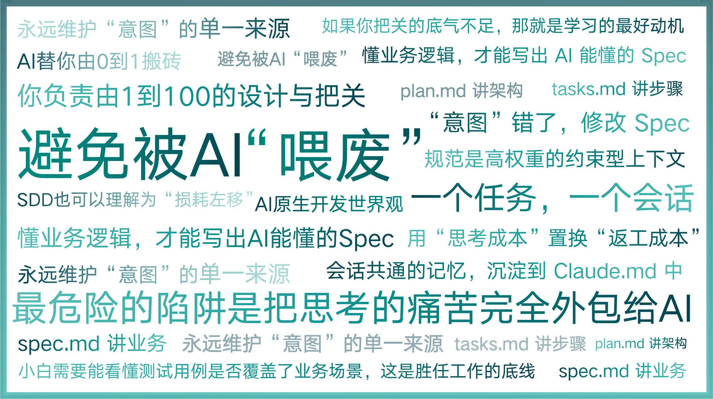
